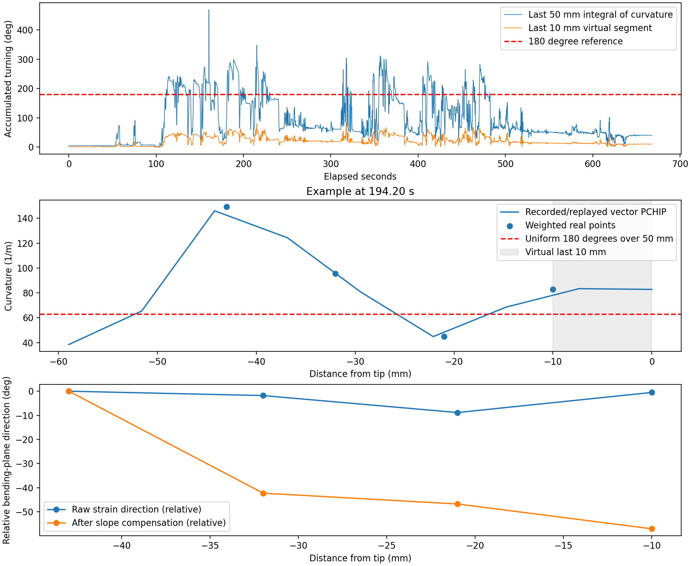

# 2026-09-18 实时末端 5 cm 过弯与扭转排查

记录：工作区 `0918_end5cm/VTK_ShapeData_20260918_111716.pkl`。
参数：项目 `params/06B6_NeTi_v2_ftube_nophase_ang0_lastweight_angwindow.json`。
共 45,489 帧，667.88 秒。实验包含 y、z 正负四方向弯曲，未标记每次真实 180° 的时间。

## 结论及适用范围

复制加权后的末点会把高曲率延伸至最后 10 mm，但不是此次过弯的唯一来源，也没有重复乘权重。多个真实点的加权曲率已经较大。奇怪的空间旋转主要需要排查当前 curvature-dependent slope 补偿：示例帧中它把较一致的原始应变方向变成明显旋转的弯曲方向。关闭 full transported phase 并不会关闭原有分段 slope 相位补偿。

本报告使用 `∫κ ds × 180/π` 衡量累计切向转动。它在平面且同向弯曲时对应圆弧角度；存在空间旋转时，不能当成带符号的平面弯曲角，也不能当成首尾切向夹角。没有外部角度标记，不能把选取帧直接认定为真实 180°；软件累计曲率、各段贡献及软件补偿造成的方向变化可直接核验。

## 软件链路核对

- demonstrator 顺序 pickle 记录包含 raw_data、22 个真实点 magnitude/angle、24 个含虚拟点的 cur_kal/ang_filter，以及120点 cur_interp/ang_interp。
- 原始数据已转换为应变；中心列从外围三列相减后用于重构。对非有限行复现实时逻辑，使用上一帧对应行。
- 包指定 TNN、vector_pchip、三点方向窗口。窗口保持真实节点模长，不把 Kalman 曲率用于向量插值。
- 真实点坐标最后四点为 0.834/0.845/0.856/0.867 m；虚拟末点为 0.877 m。末端5cm为 0.827–0.877 m，包含最后10mm真实物理余段。
- 对抽取帧与极端峰值帧，用原始应变重新装配 direct=0，真实点幅值和角度与记录一致。多数抽取帧的 vector PCHIP 输出误差小于 1e-13。523.08秒帧有约0.03444 m^-1的插值差异；离线插值未复现跨帧 unwrap limit，此帧不作为核心反事实证据。
- 参数包 direction_blend_enabled=False，direction_reference_direct=0；上述真实点重现也支持记录使用 direct=0。四个实验方向不会自动选择120/240参数。
- 虚拟点在真实点加权装配后复制 magnitude[-1] 与 angle[-1]；它不参与评分，也不再次乘 weight。复制的方向角相同，不直接在22点到虚拟点之间新增 slope 相位。

## 194.20 秒示例帧（12900）

该帧无非有限原始值，原始应变到插值曲率可重现。

| 全局真实点 | 距末端 mm | 基础曲率 m^-1 | 有效 weight | 加权曲率 m^-1 | 有效 slope rad/m |
|---|---:|---:|---:|---:|---:|
|19|43|79.13|1.8846|149.13|-64.06|
|20|32|50.64|1.8839|95.39|-64.19|
|21|21|28.65|1.5672|44.89|4.05|
|22|10|17.32|4.7787|82.78|-29.55|

若50mm均匀圆弧弯180°，参考曲率为62.83 m^-1，参考半径15.92mm；非均匀真实弯曲可以有更大的局部曲率，此参考不等于每个点的独立实测真值。

| 仅用于诊断的离线对照 | 末端50mm累计角 ° | 最后10mm累计角 ° |
|---|---:|---:|
|实际记录：复制加权末点|255.98|47.26|
|只把虚拟末点曲率设零|235.41|27.20|
|只把虚拟末点改为未加权末点|239.77|31.42|
|真实22点和虚拟末点同时取消weight|197.98|10.02|

最后10mm的47.26°不是全部额外误差：均匀180°圆弧的这10mm本来应贡献36°。把虚拟末点设零仍有27.20°，因为22点曲率仍然很高，点间插值会渐变到零；受方向窗口影响，对照还可轻微改变此前区间。直接删掉这段会缩短实际传感器长度，不能用作修复。

原始应变在均匀外围三通道模型下给出的方向为105.94/104.13/97.09/105.42°，范围8.85°；经过 slope 补偿后为106.07/63.80/59.32/49.02°，范围57.04°。19→20的有效 slope 约-64.19 rad/m，11mm间隔引入约-40.45°相位，直接解释该段的大方向变化。全局常数相位不能消除这一空间方向变化。

在等间隔外围模型下，正标量 weight 本身改变幅值，不直接旋转真实点方向；slope 改变角度。插值和方向窗口随后也会影响点间方向。因此应分别核验幅值补偿与相位补偿，不把扭转归因于末端weight或虚拟点重复加权。

## 其他数据证据

129.85秒示例：末端累计208.52°，虚拟末段44.74°。只设虚拟末点为零后189.01°；只改虚拟点为未加权值后193.14°。这一帧也显示虚拟末点只是部分贡献。

全记录16.32%的帧末端累计曲率超过180°，95分位239.96°。不同时间包含不同实际弯曲程度，此比例不是180°实验的误差率。

194.30秒峰值帧累计488.25°，19/20/21点补偿曲率为229.09/227.76/195.68 m^-1，虚拟末段46.60°；异常主要已在真实点中。该帧含非有限原始值，已复现上一帧替换逻辑。全记录共9帧含非有限原始数据。不能只凭这些记录判定峰值是机械变化、通道异常还是采集问题，需要与时间邻域核对，不能把极端峰值作为已知180°稳态证据。

## 参数优化质量

来源包 direct=0/end5cm：slope阶段状态 `no_improvement`（不表示最终loss未下降），start_loss=0.0373198，final_loss=0.0157099；weight阶段 `converge`，final_loss=0.0241496。

20个weight中7个触及上界、4个触及下界；20个slope中10个触及有效边界，13个超过配置50 rad/m范围，有效范围继承至82.3029 rad/m。不同曲率等级的slope具有明显大小与符号差异。实际末点有效weight是按等级混合的4.7787，并非直接使用某个4.999999的表项。

这些证据支持当前几何拟合的幅值与方向模型存在适用性问题；不能单凭weight触边认定独立末点补偿思路无效。四方向动态应用固定direct=0，以及曲率等级改变导致slope相位改变，均应优先核验。

## 后续顺序

1. 先用这份记录继续比较三套参数在四方向上的空间相位变化，核验为何end5cm的slope把原始方向变得更不一致；方向模型正确性先于继续放大末点weight。
2. 在相位稳定后，再核验真实19–22点的幅值响应与补偿；不能通过改虚拟点或扩大统一weight来掩盖真实点误差。
3. 若幅值仍存在随曲率变化的偏差，再研究有实测依据的逐点单调非线性补偿。

本次未启动优化，未修改生产重构、旧参数包或原始记录。新增可重复的诊断脚本、数值结果与图。

重现（从项目目录运行）：

```powershell
python tools/diagnose_recorded_end5.py ../0918_end5cm/VTK_ShapeData_20260918_111716.pkl params/06B6_NeTi_v2_ftube_nophase_ang0_lastweight_angwindow.json --output docs/recorded-end5-20260918
```


